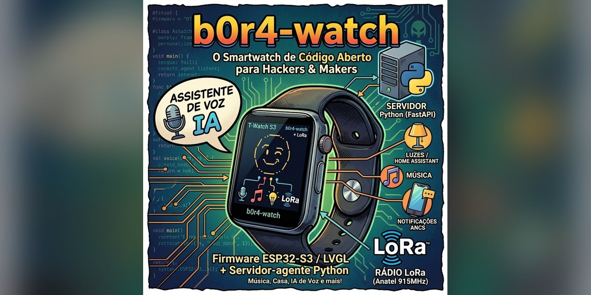
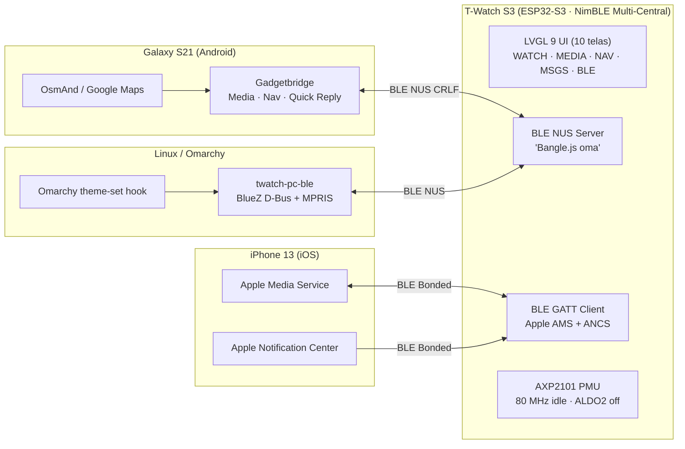

<p align="center">
  
</p>

<p align="center">
  <a href="https://github.com/leonardobora/b0r4-watch/stargazers"></a>
  <a href="https://github.com/leonardobora/b0r4-watch/blob/main/LICENSE"></a>
  <a href="https://github.com/leonardobora/b0r4-watch/issues"></a>
  <a href="https://github.com/leonardobora/b0r4-watch/pulls"></a>
  <a href="https://github.com/leonardobora/b0r4-watch/commits"></a>
  <a href="https://github.com/leonardobora/b0r4-watch/languages/top/leonardobora/b0r4-watch"></a>
  <a href="https://github.com/leonardobora/b0r4-watch/repo-size"></a>
</p>

<p align="center">
  <a href="https://www.buymeacoffee.com/leonardobora" target="_blank" rel="noopener">
    
  </a>
</p>

<p align="center">
  <b>Smartwatch pessoal open-source no LILYGO T-Watch S3 — UI Omarchy, BLE multi-central, Apple AMS/ANCS, Gadgetbridge + Ride HUD.</b><br>
  <sub>Firmware ESP32-S3 + LVGL 9 (<code>firmware/</code>) + bridges sem dependências para Linux/Omarchy e Android/Termux (<code>companion/</code>).</sub>
</p>

---

## O que é isso?

Um **smartwatch open-source** construído no **LILYGO T-Watch S3** (ESP32-S3, tela touch ST7789 240×240, acelerômetro BMA423, PMU AXP2101, rádio LoRa SX1262, microfone PDM I2S e vibrador háptico):

1. **`firmware/`** — Firmware minimalista em **PlatformIO + LVGL 9.6 + NimBLE 2.5**, com cantos quadrados (`radius=0`), **8 paletas de cor** (incluindo sync ao vivo com temas do Omarchy Linux), gerenciamento real de energia (Wi-Fi `OFF` em idle, CPU a `80 MHz` + backlight boost off no deep-idle, botão lateral AXP2101 PEKEY) e **BLE multi-central** (`Bangle.js oma`) conectando simultaneamente ao **iPhone**, **Android** e **PC Linux**.
2. **`companion/`** — Bridges leves para **Linux (`twatch-pc-ble`)** via BlueZ D-Bus + MPRIS e **Android/Termux (`twatch_s21_bridge.py`)** coexistindo com o **Gadgetbridge**.
3. **`server/`** — Protótipo inicial em FastAPI (`ASR → LLM → TTS` via WebSocket), mantido como referência para a futura etapa de ditado de voz local.

> Tudo aqui é **local-first**, sem nuvem obrigatória, sem app proprietário de fabricante.

---

## Funcionalidades

Status: ✅ **Implementado** · 🔮 **Backlog**

| Funcionalidade | O que faz | Detalhe técnico | Status |
|---|---|---|---|
| **Watch Face Digital** | Relógio 24h, data, bateria, passos e ticker ao vivo (música tocando ou última mensagem) | LVGL 9, cantos retos `radius=0`, 8 paletas + sync de tema Omarchy | ✅ `SC_WATCH` |
| **Media Player Full-Screen** | Exibe faixa, artista, álbum e controla `PLAY`/`PAUSE`/`NEXT`/`PREV`/`VOL -/+` | Android (`Gadgetbridge`), iPhone (`Apple AMS` nativo), Linux (`MPRIS`) | ✅ `SC_MEDIA` |
| **Ride Mode & Nav HUD** | Setas vetoriais, distância, rua, ETA, velocidade (`km/h`), chime direcional + bloqueio anti-toque no guidão | Auto-ativa `ride:ON` ao receber `t:"nav"` (Gadgetbridge / OsmAnd / Maps) | ✅ `SC_NAV` |
| **Mensagens + Quick Reply PT-BR** | Lê notificações e responde mensagens com 1 toque (`OK`, `To indo`, `Ja chego`, `Sim`, `Nao`, `Te ligo`) | Protocolo `{"t":"notify","n":"REPLY",...}` via Gadgetbridge `RemoteInput` | ✅ `SC_NOTIF` |
| **iPhone 13 Nativo (BLE)** | Música + notificações + chamadas sem app no iPhone | Cliente GATT **Apple AMS + ANCS** + pairing/bonding Secure Connections | ✅ `ble_companion.cpp` |
| **BLE Multi-Central + Manager** | Conecta múltiplos hosts ao mesmo tempo e permite parear/desparear pela tela | NimBLE NUS (`Bangle.js oma`) + GAP `0x1800/0x2A00` + cache NVS | ✅ `SC_BLE` |
| **Linux / Omarchy Bridge** | Sincroniza relógio, tema do sistema e MPRIS sem `bleak`/`pydbus` | `companion/linux/twatch-pc-ble` via `busctl` + `gdbus` + `wpctl` | ✅ `companion/linux/` |
| **Energia & Botão Lateral** | Tela + `ALDO2` off, `80 MHz` em idle, `wakeShield` anti-toque, botão PEKEY (curto=home/sleep, longo=play/pause) | PMU AXP2101 + gating de rails (`GPS`/`RADIO`/`SPEAK`) | ✅ `main.cpp` |
| **Rádio LoRa SX1262** | Comunicação 915 MHz estilo Meshtastic (desligado por padrão para poupar bateria) | `mesh_radio.cpp` + `mesh_service.cpp` | ✅ `SC_MESH` |
| **Ditado de Voz Local** | Gravar áudio no mic PDM e transcrever local via `whisper.cpp` (S21 / hub) para responder mensagens | Captura I2S + `whisper.cpp` offline | 🔮 Backlog |

---

## Arquitetura



---

## Estrutura do repositório

```text
b0r4-watch/
├── firmware/                  # T-Watch S3 (PlatformIO + pioarduino + LVGL 9.6 + NimBLE)
│   ├── src/
│   │   ├── main.cpp           # UI (10 telas), PMU AXP2101, BMA423, botão PEKEY, serial
│   │   ├── ble_companion.*    # NimBLE NUS multi-central + Apple AMS/ANCS + PT-BR ASCII
│   │   ├── hermes_link.*      # Wi-Fi burst (15s STA, 0 mA idle)
│   │   └── mesh_*             # Rádio LoRa SX1262 (915 MHz)
│   ├── boards/                # Definição lilygo-t-watch-s3
│   ├── variants/              # Pinout LilyGO T-Watch S3
│   ├── partitions.csv
│   └── platformio.ini
├── companion/
│   ├── linux/
│   │   └── twatch-pc-ble      # Bridge BlueZ D-Bus + MPRIS + Omarchy (zero deps)
│   └── s21/
│       ├── twatch_s21_bridge.py
│       ├── twatch_s21_tui.py
│       └── install-on-s21.sh
├── server/                    # Protótipo legado FastAPI (ASR → LLM → TTS)
└── docs/                      # ADRs e documentação de design
```

---

## Build & Flash (`firmware/`)

Requer [PlatformIO](https://platformio.org/):

```bash
cd firmware
pio run -t upload --upload-port /dev/ttyACM0
```

Comandos úteis via serial (`115200` baud):
- `T<epoch>` — ajusta o relógio UTC
- `TH <name>|<bg>|<surf>|<txt>|<muted>|<acc>` — aplica paleta ao vivo
- `M0` / `M1` — desliga/liga o rádio LoRa
- `RIDE 1` / `RIDE 0` — ativa/desativa Ride Mode
- `SNAP [idx]` — captura screenshot RGB565 da tela atual

---

## Sobre o autor

**Leonardo Bora (The Neuromancer)** — desenvolvedor e estudante em Curitiba, Brasil.

Licença: [MIT](LICENSE)
